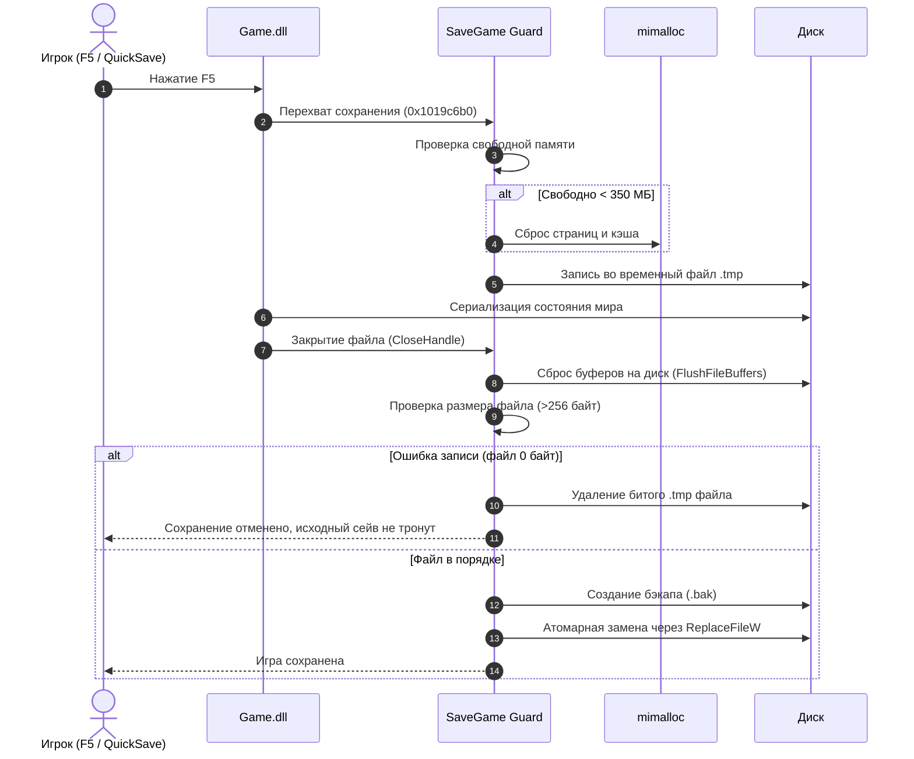

<div align="center">

[English](README_en.md) · **Русский**

# Gothic 3 Optima (G3O) Тестовая версия

### Библиотека оптимизации движка, интеграция DXVK и защита сохранений для Gothic 3

[](file:///E:/SteamLibrary/steamapps/common/Gothic%203)
[](https://github.com/doitsujin/dxvk)
[](https://github.com/microsoft/mimalloc)
[](https://github.com/ebiggers/libdeflate)
[-orange.svg?style=flat-square)](CMakeLists.txt)
[](LICENSE)

<br />

**[Установка](#установка) · [Архивы релиза](#архивы-релиза) · [Таблица изменений](#таблица-изменений) · [Защита сохранений](#защита-сохранений) · [Сборка](#сборка) · [FAQ](#faq)**

<br />

</div>

---

## О проекте

**Gothic 3 Optima (G3O)** - нативная DLL-библиотека (`dinput8.dll`), которая загружается вместе с `Gothic3.exe` и перехватывает вызовы в библиотеках движка Genome (`Engine.dll`, `Game.dll`, `SharedBase.dll`, `FileSystem.dll`, `PhysXCore.dll`).

Проект решает основные технические проблемы оригинальной игры:
1. **Фризы при перемещении по миру** - за счет многопоточной подгрузки архивов и быстрой декомпрессии через libdeflate.
2. **Вылеты с ошибкой "Where is the guru?"** - старый менеджер кучи заменен на mimalloc, включен LFH и устранены утечки адресного пространства x86.
3. **Повреждение сохранений (файлы 0 байт при сбое)** - запись теперь идет во временный файл с последующей атомарной подменой и бэкапом.
4. **Упор в один поток CPU при рендеринге Direct3D 9** - фильтрация повторяющихся RenderState и трансляция в Vulkan через DXVK.

---

## Установка

Релиз разделен на **основное ядро** и **пакеты DXVK** под разные поколения видеокарт:


### Порядок установки:

1. **Скачайте ядро:**
   - В релизах скачайте архив `Gothic3Optima-v1.1.0-Core.zip`.
   - Скопируйте `dinput8.dll` в папку игры (туда, где лежит `Gothic3.exe`).
2. **Скачайте подходящий DXVK:**
   - На той же странице выберите архив под вашу видеокарту (список ниже).
   - Скопируйте файлы из архива (`d3d9.dll`, `dxgi.dll`, `dxvk.conf`) в папку игры.
3. **Запустите игру** как обычно через Steam, GOG или `Gothic3.exe`.

---

## Архивы релиза

Все архивы прикреплены к одному релизу на GitHub:

### 1. Основное ядро (обязательно)
| Файл | Размер | Описание |
| :--- | :--- | :--- |
| **`Gothic3Optima-v1.1.0-Core.zip`** | ~119 КБ | Ядро мода (`dinput8.dll`). Содержит замену аллокатора на mimalloc, SaveGame Guard, SIMD-инструкции для геометрии, расширенный пул потоков, Multi-Ray Footprint, Combatant Culling Bypass и перехватчик сбоев. Работает как с нативным D3D9, так и с DXVK. |

### 2. Версии DXVK (выберите одну)
| Файл | Версия | Рекомендации |
| :--- | :--- | :--- |
| **`DXVK-2.4.1-Stable.zip`** | DXVK 2.4.1 Stable | **Рекомендуется по умолчанию.** Оптимальный вариант для большинства видеокарт: AMD Radeon (Polaris, Vega, RDNA 1-3) и NVIDIA GeForce (GTX 10xx, RTX 20xx/30xx/40xx). |
| **`DXVK-3.0.1.zip`** | DXVK 3.0.1 | Актуальная версия. Требует видеокарту и драйвер с полной поддержкой Vulkan 1.4. |
| **`DXVK-3.0.1-HDR.zip`** | DXVK 3.0.1 HDR | Сборка с выводом в HDR. Используйте, если играете на мониторе или ТВ с HDR при включенном режиме Windows HDR. |
| **`DXVK-1.10.3-Async.zip`** | DXVK 1.10.3 Async | Для видеокарт без поддержки Vulkan 1.3 или если версии 2.x вызывают падение драйвера. |
| **`DXVK-1.10.1-Async.zip`** | DXVK 1.10.1 Async | Для встроенной графики Intel (HD / UHD Graphics) или старых видеокарт. |

> [!TIP]
> Для стандартной системы скачивайте пару: **`Gothic3Optima-v1.1.0-Core.zip`** + **`DXVK-2.4.1-Stable.zip`**.

---

## Таблица изменений

В таблице описаны технические проблемы оригинальной игры (CP 1.75.14) и их решения в моде:

| Подсистема | Поведение оригинала | Симптом | Решение в моде | Результат |
| :--- | :--- | :--- | :--- | :--- |
| **Сохранения** | Перезапись файла напрямую (`0x1019c6b0`), размер сбрасывается в 0 при открытии | Сейв 0 байт при вылете во время F5, ошибка "Where is the guru?" | **SaveGame Guard:** сброс кэша памяти, запись в `.tmp`, проверка размера и атомарный `ReplaceFileW` | Сохранение не повредится даже при падении игры или выключении ПК |
| **Память** | Менеджер `bCMemoryAdmin`, `_new@8` со спинлоком `MemHeap::s_cLock`, CRT `HeapAlloc` | Фрагментация адресного пространства x86, статтеры из-за спинлока, вылет OOM ("Where is the guru?") | Полная замена `bCMemoryAdmin`, `_new@8`, `MemHeap` и IAT `HeapAlloc` на **mimalloc** с тремя изолированными пулами (Engine, MemHeap, ShortUsage) + LFH | Исключена внешняя фрагментация кучи, нет блокировок потоков, устранены вылеты по памяти |
| **Графика** | D3D9 без флага `D3DCREATE_PUREDEVICE`, текстуры дублируются в системной RAM | Высокий расход RAM, нагрузка на CPU валидацией вызовов в D3D9 | **DXVK** + флаг `D3DCREATE_PUREDEVICE` в `CreateDevice` | Текстуры перенесены в VRAM, освобождается до 1 ГБ системной памяти |
| **Состояния D3D9** | Движок шлет тысячи одинаковых `SetRenderState` и `SetSamplerState` за кадр | Процессорный боттлнек по числу draw calls | **State Filter:** теневая таблица состояний отсекает повторные вызовы | Меньше лишних вызовов драйвера, стабильнее минимальный фреймрейт |
| **Потоки загрузки** | Пул `eCThreadPool` (`0x101f4010`) использует всего 1-2 воркера | Замирание картинки при входе в новый сектор мира | Перехват `eCThreadPool::Create` с расширением пула до 4-8 потоков | Параллельная подгрузка и распаковка данных на многоядерных процессорах |
| **Кэш ресурсов и GC** | Агрессивный сброс недавних ассетов либо накопление мусора при долгих сессиях | Статтер при разворотах камеры, утечки памяти при переходе между регионами (Миртана/Варант/Нордмар) | **Adaptive LRU Cache Eviction (`eCMainCache`):** удержание свежих ассетов (<300с) при свободной RAM, автосброс устаревших ресурсов (>300с), очистка VRAM и фоновый watchdog | Нет статтеров при осмотре местности, память автоматически очищается при смене биомов и телепортах |
| **Декомпрессия** | Скалярный `zlib 1.2.5` в `FileSystem.dll` | Нагрузка на CPU при распаковке `.pak` контейнеров | Интеграция **libdeflate** с инструкциями AVX2 / SSE4.2 (перехват RVA `0xA430`) | Распаковка архивов в 3-4 раза быстрее |
| **Файловый ввод-вывод** | Вызовы `SetFilePointer` и `ReadFile` с небольшим буфером | Задержки дискового ввода-вывода, лишние переходы в ядро ОС | **Memory-Mapped Files (`MapViewOfFile`):** прямое проецирование архивов (бюджет 750 МБ) | Чтение данных напрямую из RAM без ожидания диска |
| **Стриминг секторов** | Статичная радиальная сфера вокруг героя в `eCPVSPrefetcher3` | Микрофризы (50-200 мс) при пересечении границы нового сектора | **Motion Vector Prefetch:** смещение сферы предвыборки по вектору движения на 10-30 м вперед | Бесшовный стриминг: ячейки мира загружаются в память до прихода игрока |
| **Геометрия и физика** | Вычисления через x87 FPU (`fld`, `fmul`, `fstp`) в `SharedBase.dll` | Медленный Frustum Culling и расчет коллизий | Перевод функций отсечения и матриц на векторные инструкции SSE | Ускорение расчетов видимости объектов |
| **Защита от провалов и геодата** | Одиночный рейкаст опоры проваливается в полигональные швы мешей ландшафта, ложные детектирования падения | Провал героя под текстуры мира, соскальзывание в щели геометрии, падение в бездну и мгновенная гибель | **Multi-Ray Footprint & Ground Recovery Fall Guard:** крестообразный пучок из 5 лучей под подошвой (радиус 0.25 м) с перехватом `TraceRayNearestHit` в `Engine.dll`, центрированием точки опоры и детектор резкого спада высоты Y ($>6$ м) с возвратом на безопасную опору и обнулением скорости падения | Герой не проваливается сквозь микрощели полигонов, устойчиво стоит на скалах и швах ландшафта, исключена гибель от багов коллизий |
| **Хэш строк** | Побайтовый цикл 2005 года в `g_GetHashValue<bCString>` | Задержки поиска объектов в таблицах при спавне NPC | Векторизованный алгоритм хэширования строк | Быстрый поиск сущностей и диалогов |
| **Планировщик CPU** | Потоки могут попадать на энергоэффективные E-ядра | Просадки FPS на процессорах Intel 12-14th Gen и AMD Hybrid | Привязка основных потоков к производительным P-ядрам | Стабильная частота кадров на гибридных CPU |
| **Физика PhysX и рэгдоллы** | Переменный шаг PhysX 2.4.1, нулевое демпфирование костей, взрывной рост импульса $F \cdot \Delta t$ и скоростей костей при клиппинге коллизий | Улетающие в небо трупы монстров, растягивание конечностей рэгдоллов, конвульсии и статтеры на мониторах >60 / 144 Гц | **Fixed Physics Substep & Bone Velocity Clamp:** фиксация шага 16.6 мс ($1/60$ с, `NX_TIMESTEP_FIXED`), демпфирование скоростей костей (0.20/0.25), отсечение аномальных скоростей костей ($\le 20$ м/с, $\le 12$ рад/с) и подавление NaN-выбросов | Естественное падение рэгдоллов без спагетти-эффекта и улетов в космос, стабильная физика на 144+ Гц |
| **Таймер кадров** | Стандартный системный таймер Windows с шагом 15.6 мс | Неровный график времени кадра при 60 / 120 FPS | Включение `timeBeginPeriod(1)` для шага таймера 1.0 мс | Ровная подача кадров (Frame Pacing) |
| **Звук FMOD** | DSP-буфер 512 сэмплов (10.6 мс), буфер чтения 16 КБ | Щелчки, треск в наушниках, выключение музыки в городах | Перехват `FMOD::System::init`: DSP-буфер 2048x4 (170.6 мс), 64 канала, 64 КБ стрим-буфер | Чистый звук без треска, музыка не прерывается при нагрузках |
| **Адресное пространство** | Ограничение 4 ГБ для 32-битного процесса | Нехватка виртуальной памяти под тяжелые архивы (`_compiledImage.pak`, `_compiledMesh.pak`) | **High Memory Shadow Cache (> 4 ГБ):** 64-битный теневой пул 2 ГБ через Heaven's Gate (`AllocateHighMemory`, `ReadHighMemory`) | Крупные архивы кэшируются в 64-битной RAM, разгружая 32-битное пространство игры |
| **Z-буфер и тени** | 24-битный целочисленный Z-буфер D24S8/D16, нелинейная потеря точности на дистанциях FarClipPlane ($1/z$), недостаточное смещение теней, мерцание полигонов (Z-fighting) | Полосатый шум и зернистые артефакты теней (Shadow Acne), мерцание дальних гор, деревьев и скал | **Высокоточный плавающий Z-буфер (`VK_FORMAT_D32_SFLOAT`) и Shadow Depth Bias Hook:** трансляция `d3d9.useD32forD24 = True`, `d3d9.supportD32 = True`, строгая точность шейдеров `d3d9.floatEmulation = Strict`, автоапгрейд D16 в D24/D32, инвариантность позиций `invariantPosition` и динамическая коррекция смещения теней `D3DRS_DEPTHBIAS` (1.35x) и `D3DRS_SLOPESCALEDEPTHBIAS` (1.50x) | Высокая точность глубины на дистанциях до 1000 м, полное устранение мерцания Z-fighting и полосатого самозатенения (Shadow Acne) на лицах и скалах |
| **Вершинные и индексные буферы** | Ограничение 16-битных индексов (до 65535 вершин), статичные размеры пулов геометрии (рост по 1024), малые динамические буферы (64-256 КБ) | Исчезновение и мерцание зданий, разрывы высокополигональных мешей в модах, статтеры из-за частых реаллокаций батчей | **Динамическое масштабирование буферов и автопродвижение 32-битных индексов (`D3DFMT_INDEX32`):** перехват `CreateVertexBuffer` / `CreateIndexBuffer` (минимум 1 МБ / 512 КБ, 2x расширение), расширение шага пула инстансов в `Engine.dll` до 4096 и автопереключение на 32-битные индексы при $>65535$ вершин | Стабильный рендеринг тяжелых модов и высокополигональных моделей без исчезновения геометрии и искажения полигонов |
| **Боевой фокус ИИ (Aggro)** | Выгрузка сущностей из обработки при выходе из конуса камеры (`ExtractFromEntity`: `CullTreeHC`, `CullVPTHC`, `CullSmallObject`) | Преследующие монстры и враги за спиной игрока застывают на месте или теряют цель при отвороте камеры | **Combatant Culling Bypass (`src/combat_guard.cpp`):** перехват функций отсечения дерева видимости и конуса камеры в `Engine.dll` для комбатантов (`gCNPC_PS`), атакующих игрока в радиусе 65 м | Враги непрерывно преследуют героя и ведут бой вне зависимости от направления взгляда камеры |

---

## Защита сохранений

Схема работы SaveGame Guard:



---

## Структура модулей

- `heavens_gate/` - переход из 32-битного режима в 64-битный через селектор сегмента (`retf 0x33`) для выделения памяти за пределами 4 ГБ через 64-битную `ntdll.dll`.
- `src/memory_allocator.cpp` и `src/lfh_enforcer.cpp` - полная замена `bCMemoryAdmin`, глобального `_new@8`, методов `MemHeap` и IAT `HeapAlloc` на mimalloc с тремя изолированными пулами по времени жизни объектов; принудительное включение LFH для системных куч.
- `src/d3d9_hook.cpp` - добавление флага `D3DCREATE_PUREDEVICE`, теневой кэш состояний рендера, фильтрация повторных вызовов D3D9, автоапгрейд формата Z-буфера до 24/32-бит, активация возможностей Depth Bias / Slope Scale, динамическая калибровка смещения теней (Depth Bias 1.35x, Slope Scale 1.50x), динамическое масштабирование вершинных/индексных буферов (1-8 МБ), расширение пула инстансов до 4096 и автопродвижение на 32-битные индексы `D3DFMT_INDEX32`.
- `src/streaming_optimizer.cpp` - проецирование архивов `.pak` в RAM (`MapViewOfFile`), прогнозирующий стриминг ячеек по вектору движения (`eCPVSPrefetcher3`) и расширение пула потоков `eCThreadPool` до 4-8 воркеров.
- `src/media_optimizer.cpp` - аппаратная SIMD-распаковка `.pak` через `libdeflate` (AVX2/SSE4.2), расширение DSP-буфера FMOD Ex (2048x4) и таймер высокой точности 1.0 мс.
- `src/math_simd_optimizer.cpp` - перенос отсечения геометрии `bCFrustum::Cull` и операций с матрицами на SSE-инструкции.
- `src/fall_guard.cpp` - пучок лучей под подошвой (Multi-Ray Footprint), защита от провалов сквозь полигональные швы геометрии (`TraceRayNearestHit`) и автовозврат на безопасную опору (Ground Recovery Fall Guard) с обнулением урона падения.
- `src/combat_guard.cpp` - исключение активных комбатантов из Frustum Culling (`CullTreeHC`, `CullVPTHC`, `CullSmallObject`) для непрерывного боя и преследования при отворотах камеры.
- `src/physics_stabilizer.cpp` - стабилизация рэгдоллов PhysX (`eCPhysicsScene::Simulate` и `CreateActor`), фиксированный квант `NX_TIMESTEP_FIXED` (16.6 мс / 60 Гц), демпфирование скоростей костей (0.20/0.25), принудительное отсечение аномальных скоростей твердых тел скелета ($\le 20$ м/с, $\le 12$ рад/с) и нейтрализация NaN-взрывов суставов.
- `src/lru_cache_manager.cpp` - адаптивный сборщик мусора кэша ресурсов `eCMainCache`, удержание свежих ассетов (<300с), очистка VRAM и сброс неактивных ресурсов при переходе между биомами.
- `src/savegame_guard.cpp` - запись сейва в `.tmp`, валидация размера, создание копии `.bak` и атомарная подмена через `ReplaceFileW`.
- `src/version_watermark.cpp` - индикация версии и статуса Gothic 3 Optima в главном меню игры.

---

## Сборка

### Требования:
- Windows 10 / 11 (x64)
- Visual Studio 2022 (компоненты C++ x86)
- CMake 3.20+
- Git

### Команды:

```cmd
git clone https://github.com/VadimGlinskiy/G3O.git
cd G3O

cmake -B build -S . -A Win32 -DCMAKE_BUILD_TYPE=Release
cmake --build build --config Release
```

Собранная библиотека: `build/Release/dinput8.dll`.

Для сборки релизных архивов запустите:
```powershell
powershell -ExecutionPolicy Bypass -File .\scripts\package_releases.ps1
```
Архивы появятся в каталоге `dist/packages/`.

---

## FAQ

<details>
<summary><strong>Совместим ли мод с Community Patch 1.75.14 и Update Pack 1.04.11 / 1.05.10 (PublicBeta)?</strong></summary>

Да. Мод полноценно протестирован и проверен на Gothic 3 v1.75.14 как с Update Pack v1.04.11, так и с новейшим Update Pack v1.05.10 (PublicBeta). Динамическое связывание хуков по экспортируемым именам C++ гарантирует полную совместимость с обеими версиями движка.
</details>

<details>
<summary><strong>Работает ли с модами (Questpaket, Content Mod, LCTM)?</strong></summary>

Да. Мод меняет только бинарный код движка и системные вызовы. Шаблоны предметов, скрипты квестов и баланс не затрагиваются.
</details>

<details>
<summary><strong>Как включить оверлей DXVK (FPS, память)?</strong></summary>

Откройте `dxvk.conf` в папке игры и добавьте строку:
```ini
dxvk.hud = fps,frametimes,memory,devinfo
```
</details>

<details>
<summary><strong>Что делать при черном экране или ошибке Vulkan?</strong></summary>

Скачайте архив `DXVK-1.10.1-Async.zip` или `DXVK-1.10.3-Async.zip` и распакуйте в папку игры. У них максимальная совместимость со старыми видеокартами и драйверами.
</details>

<details>
<summary><strong>Где искать бэкапы сохранений?</strong></summary>

В вашей обычной папке сохранений (`Документы\gothic3\`). При каждой перезаписи старый файл сохраняется с расширением `.bak`. Если нужно вернуть его, просто переименуйте в `.g3savdat`.
</details>

---

## Благодарности и сторонние компоненты

Проект Gothic 3 Optima использует и опирается на наработки следующих открытых библиотек, авторов и исследовательских проектов:

| Компонент / Проект | Автор / Организация | Лицензия | Назначение в Gothic 3 Optima |
| :--- | :--- | :--- | :--- |
| **[DXVK](https://github.com/doitsujin/dxvk)** | Philip Rebohle ([doitsujin](https://github.com/doitsujin)) и участники проекта | Zlib License | Трансляция вызовов Direct3D 9 в нативный Vulkan, перенос создания текстур и компиляции шейдеров в фоновые Vulkan Transfer Queues, поддержка 32-битного плавающего буфера глубины. |
| **[DXVK-Async](https://github.com/Sporif/dxvk-async)** | [Sporif](https://github.com/Sporif) | Zlib License | Патч асинхронной компиляции графических конвейеров для классических версий DXVK 1.10.x. |
| **[mimalloc](https://github.com/microsoft/mimalloc)** | Daan Leijen ([Microsoft Research](https://github.com/microsoft)) | MIT License | Компактный высокоскоростной распределитель памяти, исключающий внешнюю фрагментацию и заменяющий медленный менеджер кучи `bCMemoryAdmin`. |
| **[libdeflate](https://github.com/ebiggers/libdeflate)** | Eric Biggers ([ebiggers](https://github.com/ebiggers)) | MIT License | Высокоскоростной декомпрессор zlib/deflate с аппаратной SIMD-векторизацией SSE4.2 / AVX2 для быстрой распаковки мешей и текстур из `.pak` архивов. |
| **[MinHook](https://github.com/TsudaKageyu/minhook)** | Tsuda Kageyu ([TsudaKageyu](https://github.com/TsudaKageyu)) | BSD 2-Clause | Минималистичная и потокобезопасная библиотека низкоуровневых API-перехватов (detours/trampolines) для x86. |
| **[Heaven's Gate](https://github.com/Gothic3Optima)** | Roy M. ([ReWolf](https://github.com/mwrl)), mixcode, antivm | Public Domain | Архитектурная концепция переключения процессора x86 $\to$ x64 через селектор сегмента `0x33` для доступа к памяти за пределами 4 ГБ в Windows x64. |
| **Community Patch Team (CPT)** | CPT Team | - | За титанический труд над Community Patch 1.75.14, декомпиляцию бинарников Genome Engine и спасение игры. |
| **Update Pack Team** | zandr, Dimus и сообщество World of Players | - | За разработку Update Pack 1.04.11 и 1.05.10 PublicBeta, исправление сотен скриптов и стабилизацию библиотек `Engine.dll` / `Game.dll`. |
| **Piranha Bytes** | Piranha Bytes | - | Создатели бессмертной вселенной Gothic и оригинального движка Genome Engine. |

---

## Лицензия

Исходный код Gothic 3 Optima распространяется под лицензией [MIT](LICENSE).  
Все сторонние компоненты остаются собственностью их авторов и распространяются под своими оригинальными лицензиями.
