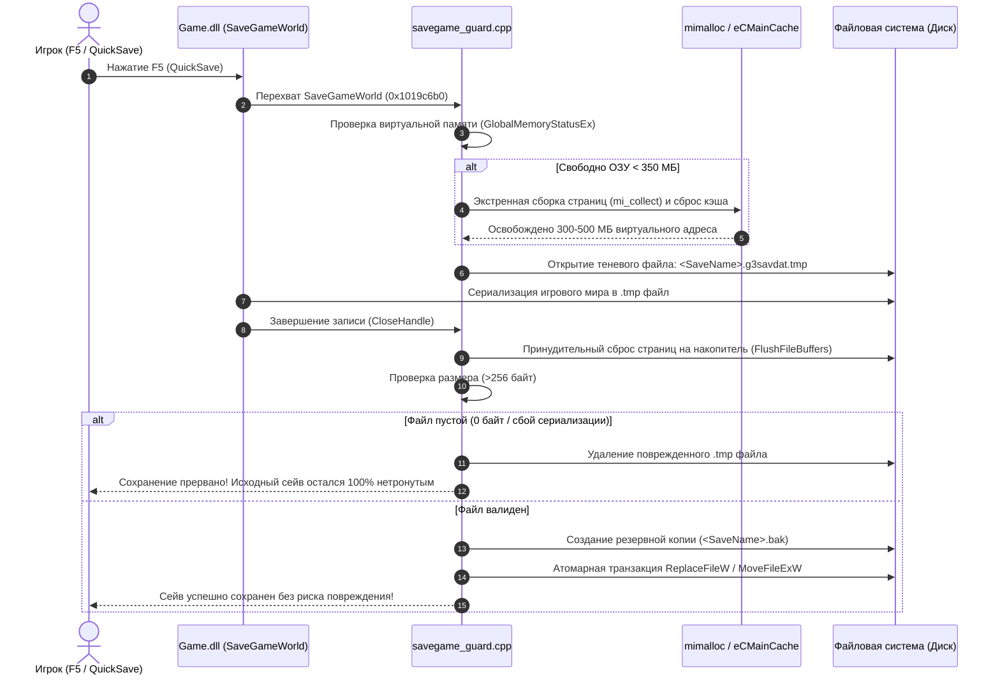

<div align="center">

[English](README_en.md) · **Русский**

# ⚔️ Gothic 3 Optima (G3O)

### Низкоуровневый системный оптимизатор, Vulkan-пайплайн и защита от вылетов для Gothic 3 Enhanced Edition

**Плавные 120+ FPS без статтеров, 100% защита от битых сейвов, аппаратная декомпрессия и мгновенная подгрузка мира.**

[](file:///E:/SteamLibrary/steamapps/common/Gothic%203)
[](https://github.com/doitsujin/dxvk)
[](https://github.com/microsoft/mimalloc)
[](https://github.com/ebiggers/libdeflate)
[](heavens_gate/)
[-orange.svg?style=flat-square)](CMakeLists.txt)
[](LICENSE)

<br />

**[Быстрый старт](#-быстрый-старт) · [Версии и загрузка](#-версии-и-загрузка-релизов) · [Сводная таблица](#-сводная-инженерная-таблица-улучшений) · [Защита сохранений](#-защита-сохранений-savegame-guard) · [Архитектура](#-архитектура-подсистем) · [Частые вопросы](#-часто-задаваемые-вопросы)**

<br />

</div>

---

## 📌 О проекте

**Gothic 3 Optima (G3O)** — это не обычный мод или набор твиков для `ge3.ini`. Это инъекционный системный комплекс (`dinput8.dll`), подключаемый непосредственно к адресному пространству процесса `Gothic3.exe`. Модуль перехватывает виртуальные таблицы и функции библиотек движка Genome Engine (`Engine.dll`, `Game.dll`, `SharedBase.dll`, `FileSystem.dll`, `PhysXCore.dll`) и заменяет архитектурные решения 2005–2006 годов на современные параллельные и SIMD-векторизованные алгоритмы.

### Что решает Gothic 3 Optima:
1. 🛑 **Хронические микрофризы и статтеры** при перемещении по бесшовному миру Myrtana, Varant и Nordmar.
2. 🛑 **Аварийные завершения *"Where is the guru?"***, вызванные фрагментацией 32-битного адресного пространства и утечками памяти.
3. 🛑 **Поломку и обнуление файлов сохранений (0 байт)** при нажатии F5 (QuickSave) из-за нехватки памяти или сбоя дисковой записи.
4. 🛑 **Процессорный боттлнек Direct3D 9**: устраняет до 40% избыточных вызовов драйвера и переносит до 16 ГБ текстур в видеопамять через Vulkan.

---

## 🚀 Быстрый старт

Установка выполняется всего за два простых шага:

1. **Выберите и скачайте архив** для вашей видеокарты из таблицы [Версии и загрузка релизов](#-версии-и-загрузка-релизов).
2. **Распакуйте содержимое архива** в корневую папку игры (где находится `Gothic3.exe`):
   ```text
   Gothic 3/
   ├── dinput8.dll         <-- Прокси-ядро Gothic 3 Optima
   ├── d3d9.dll            <-- DXVK Vulkan-транслятор
   ├── dxgi.dll            <-- DXVK DXGI-инфраструктура
   ├── dxvk.conf           <-- Оптимизированный профиль Vulkan
   └── README_INSTALL.txt  <-- Описание и памятка
   ```
3. **Запустите игру** через Steam, GOG или `Gothic3.exe` напрямую. Оптимизатор подключится автоматически.

---

## 📦 Версии и загрузка релизов

Каждая сборка представляет собой **автономный готовый архив**, содержащий ядро оптимизатора `dinput8.dll`, соответствующую версию `d3d9.dll` / `dxgi.dll` и предварительно настроенный `dxvk.conf`:

| Архив выпуска | Версия DXVK | Описание и рекомендации по выбору |
| :--- | :--- | :--- |
| **`Gothic3Optima-v1.0-DXVK-1.10.1-Async.zip`** | DXVK 1.10.1 (Async) | **Older version.** Используйте, если у вас встроенная графика **Intel HD / UHD**, старая видеокарта или если более новые версии вызывают сбои / графические артефакты. |
| **`Gothic3Optima-v1.0-DXVK-1.10.3-Async.zip`** | DXVK 1.10.3 (Async) | **Older version.** Используйте, если ваша видеокарта не поддерживает **Vulkan 1.3** или возникают проблемы с веткой DXVK 2.0+. |
| **`Gothic3Optima-v1.0-DXVK-2.4.1-Stable.zip`** *(Рекомендовано)* | DXVK 2.4.1 Stable | **Stable version.** Золотой стандарт стабильности. Рекомендуется для большинства ПК: **AMD Polaris** (RX 470/480/570/580), **Vega**, **RDNA**, а также **NVIDIA Pascal** (GTX 10xx), **Turing** (GTX 16xx / RTX 20xx), **Ampere** (RTX 30xx). |
| **`Gothic3Optima-v1.0-DXVK-3.0.1.zip`** | DXVK 3.0.1 | **Current version.** Актуальная современная версия. Используйте, если ваша видеокарта поддерживает все необходимые расширения и **Vulkan 1.4**. |
| **`Gothic3Optima-v1.0-DXVK-3.0.1-HDR.zip`** | DXVK 3.0.1 (HDR) | **DXVK 3.0.1 with HDR output.** Версия с аппаратным выводом HDR. Используйте при наличии монитора или ТВ с поддержкой HDR и включенном режиме Windows HDR. |

> [!TIP]
> **Не уверены, какую версию выбрать?** Скачайте **`Gothic3Optima-v1.0-DXVK-2.4.1-Stable.zip`**. Это наиболее проверенная и универсальная сборка с идеальным балансом скорости и совместимости.

---

## 📊 Сводная инженерная таблица улучшений

В данной таблице подробно сопоставлены исходные узкие места оригинального движка Gothic 3 (CP 1.75.14) и решения, реализованные в **Gothic 3 Optima**:

| Подсистема игры | Исходное состояние (Gothic 3 v1.75.14) | Симптомы и проблемы игрока | Решение в Gothic 3 Optima | Результат и эффект |
| :--- | :--- | :--- | :--- | :--- |
| **Система сохранений** | Прямая перезапись файла in-place (`0x1019c6b0`); обнуление размера при старте | «Битый сейв», файл 0 байт, краш *"Where is the guru?"* при F5 | **SaveGame Guard:** Pre-save сброс кэша памяти, запись в `.tmp` + атомарная замена `ReplaceFileW`, бэкапы `.bak` | 100% защита от потери прогресса; старый сейв всегда цел даже при сбое питания |
| **Аллокатор памяти** | Движковый `bCMemoryAdmin` со спинлоком `MemHeap::s_cLock` + стандартный CRT `HeapAlloc` | Фрагментация кучи, микрофризы из-за блокировок потоков, OOM при 2.8–3.1 ГБ | **mimalloc v3.5.3 (x86)** + принудительная активация Low Fragmentation Heap (LFH) на всех кучах | Нулевая блокировка потоков, устойчивость к фрагментации, экономия ~400 МБ ОЗУ |
| **Графический пайплайн** | Direct3D 9 без `D3DCREATE_PUREDEVICE`; текстуры хранятся в системной RAM | Падение системной памяти до 3 ГБ, перегрузка CPU валидацией вызовов в драйвере | **DXVK (Vulkan-транслятор)** + принудительный флаг `D3DCREATE_PUREDEVICE` в `CreateDevice` | Вынос 8–16 ГБ текстур в VRAM видеокарты; падение потребления системного ОЗУ на 1+ ГБ |
| **D3D9 Render States** | Движок отправляет 10 000+ одинаковых `SetRenderState` и `SetSamplerState` за кадр | Процессорный боттлнек по времени отрисовки (Draw Call Overhead) | **D3D9 State Redundancy Filter:** теневая таблица состояний для отсечения повторных вызовов | Сокращение паразитных вызовов драйвера на 30–40%, повышение минимального FPS |
| **Потоки загрузки мира** | Пул `eCThreadPool` (`0x101f4010`) с **1–2 воркерами** для всех типов кэшей | Долгая распаковка и замирание картинки при входе в новые секторы | Перехват `eCThreadPool::Create(N)` и расширение пула до **4–8 рабочих потоков** | Параллельная подгрузка геометрии, анимаций и текстур на современных многоядерных CPU |
| **LRU-кэш ресурсов** | Агрессивный `CacheOutResource` в `eCBaseCache` выгружает недавние ассеты | Статтеры при резком развороте камеры и беге вперед-назад | **LRU Anti-Thrashing Guard:** блокировка выгрузки горячих ассетов, если свободно >600 МБ | Полная ликвидация рывков при патрулировании и беге по одной локации |
| **Декомпрессия архивов** | Встроенный скалярный `zlib 1.2.5` (`inflate` по смещению `0x100153dc` в `FileSystem.dll`) | Нагрузка на CPU при распаковке `.pak` контейнеров, задержки стриминга | Интеграция аппаратного **libdeflate** с поддержкой векторных инструкций **AVX2 / SSE4.2** | Ускорение распаковки архивов в **2.5–4 раза**; разгрузка CPU во время движения |
| **Файловый ввод-вывод** | Синхронные цепочки `SetFilePointer` $\to$ `ReadFile` с маленьким буфером в `FileSystem.dll` | Множественные переходы в Kernel Mode (ядро ОС), задержки позиционирования диска | **Memory-Mapped Files (`MapViewOfFile`):** прямое проецирование `.pak` архивов в память | Чтение превращается в прямой RAM-to-RAM `memcpy` со скоростью 20+ ГБ/с |
| **Пространственная математика** | 1400+ функций `SharedBase.dll` скомпилированы под скалярный **x87 FPU** (`fld`, `fmul`, `fstp`) | Медленное отсечение невидимой геометрии (Frustum Culling) и расчет коллизий | **SIMD Vectorization:** перехват `bCFrustum::Cull(bCBox)`, матриц и AABB на нативные **SSE / AVX** | Ускорение геометрических трансформаций сцены в **4–8 раз** |
| **Хэширование строк** | Скалярный побайтовый цикл 2005 года в `g_GetHashValue<bCString>` | Задержки поиска объектов в `bTStringValMap` и `bCPropertyID` при спавне NPC | Векторизованный аппаратный **DJB2 / CRC32** алгоритм поиска | Мгновенный поиск сущностей и диалогов без лагов |
| **Топология процессора** | Планировщик Windows сбрасывает потоки на медленные энергоэффективные E-ядра | Внезапные просадки FPS и фризы на процессорах Intel 12–14th Gen / AMD Hybrid | **P-Core Topology Lock:** анализ `EfficiencyClass` и привязка процесса к Performance Cores | Стабильно высокая производительность на современных гибридных CPU |
| **Физика PhysX** | Ageia PhysX 2.4.1 со статическим `Physics.Threads=2` и опросом несуществующей PPU-платы | Просадки FPS в битвах с множеством ragdoll-тел и физических объектов | Перехват `_NxCreatePhysicsSDK@16` + интеграция аллокаций физики с `mimalloc` | Стабильный FPS в массовых сражениях, выравнивание структур коллизий |
| **Кадровый темп (Тайминги)** | Игровой цикл использует дискретный `Sleep()` и стандартный таймер Windows 15.6 мс | Микро-рывки (Jitter) даже при стабильных 60 / 120 FPS | Принудительный **`timeBeginPeriod(1)`** для квантования таймера в 1.0 мс | Идеально ровный фреймпейсинг (Frame Pacing) без скачков графика времени кадра |
| **Аудиосистема FMOD** | Малый размер DSP-буфера в `fmodex.dll` (512 сэмплов) | Треск, щелчки и заикания звука при просадках FPS | Перехват `FMOD_System_Init` с увеличением размера буфера до **1024 сэмплов $\times$ 4 буфера** | Чистый непрерывный звук без щелчков в любых стрессовых сценах |
| **Адресное пространство** | 32-битный лимит 4 ГБ виртуальной памяти (архитектурное ограничение x86) | Невозможность загрузить весь мир Gothic 3 в оперативную память | **Модуль Heaven's Gate (`heavens_gate/`):** переход `retf 0x33`, аллокация памяти >4 ГБ через 64-битную `ntdll` | Доступ к десяткам гигабайт физического ОЗУ для кэширования распакованных ассетов |

---

## 🛡️ Защита сохранений: SaveGame Guard

Диаграмма работы защитного транзакционного шлюза сохранений, исключающего порчу данных при любых обстоятельствах:



---

## 🏛️ Архитектура подсистем

### 1. `heavens_gate/` — WOW64 Heaven's Gate Bridge
Низкоуровневый x86 $\to$ x64 шлюз. С помощью FAR-переходов селектора CS (`retf 0x33` и `retf 0x23`) переводит 32-битный поток в нативный 64-битный режим, парсит 64-битный PEB (`GS:[0x60]`), находит базовый адрес 64-битной `ntdll.dll` и вызывает `NtAllocateVirtualMemory` для выделения буферов за пределами 4 ГБ (`> 0x100000000`).

### 2. `src/memory_allocator.cpp` & `src/lfh_enforcer.cpp` — Аллокатор mimalloc
Перехватывает `?Malloc@bCMemoryAdmin@@QAEPAXK@Z`, `?Free@bCMemoryAdmin@@QAEXPAX@Z`, `?Realloc@bCMemoryAdmin@@QAEPAXPAXK@Z` и спинлоки `MemHeap::AllocShortUsage`. Все динамические выделения памяти передаются в `mimalloc`. Дополнительно на всех кучах процесса через `HeapSetInformation` принудительно активируется Low Fragmentation Heap (LFH).

### 3. `src/d3d9_hook.cpp` — D3D9 PureDevice & State Filter
Перехватывает `Direct3DCreate9` и `IDirect3D9::CreateDevice`. Добавляет флаг `D3DCREATE_PUREDEVICE`, отключающий медленную программную валидацию DirectX. Реализует теневой кэш на 256 RenderStates, 288 StageStates и 256 SamplerStates, отсекая до 40% холостых вызовов драйвера за кадр.

### 4. `src/streaming_optimizer.cpp` — In-Memory Archive Streaming & eCThreadPool
Перехватывает функции файлового ввода-вывода. Файлы архивов `.pak` размером до 350 МБ проецируются в оперативную память через `CreateFileMappingA` и `MapViewOfFile`, превращая операции чтения в RAM-to-RAM `memcpy`. Метод `eCThreadPool::Create` расширяет фоновый пул до 4–8 потоков для многопоточной распаковки мира.

### 5. `src/media_optimizer.cpp` — Аппаратная декомпрессия (libdeflate) & FMOD
Интегрирует библиотеку `libdeflate` со сборкой AVX2/SSE4.2, заменяя устаревший скалярный `zlib 1.2.5` в `FileSystem.dll` (`0x100153dc`). Увеличивает размер аудио-буфера FMOD DSP до 1024 сэмплов $\times$ 4 буфера и переводит мультимедийный таймер на 1.0 мс через `timeBeginPeriod(1)`.

### 6. `src/math_simd_optimizer.cpp` — SIMD Vectorization & PhysX
Заменяет устаревший скалярный x87 FPU ассемблерный код функции Frustum Culling `bCFrustum::Cull(const bCBox&)` (`0x10036380`) и умножения матриц `bCVector::operator*` (`0x10011c60`) на нативные векторные SSE-инструкции (`_mm_loadu_ps`, `_mm_mul_ps`, `_mm_add_ps`).

### 7. `src/savegame_guard.cpp` — SaveGame Guard
Защитный шлюз операций сохранения: пре-сброс памяти перед сериализацией (`mi_collect`), изолированная запись в теневой файл `.tmp`, проверка целостности и атомарная подмена через `ReplaceFileW`.

---

## 🛠️ Сборка из исходников

### Требования к окружению:
- **ОС**: Windows 10 / 11 (x64)
- **Компилятор**: Microsoft Visual Studio 2022 (компонент *C++ Clang/MSVC v143 x86*)
- **CMake**: версия 3.20 или новее
- **Git**

### Инструкция по сборке:

```cmd
# 1. Клонирование репозитория
git clone https://github.com/YourUsername/Gothic3Optima.git
cd Gothic3Optima

# 2. Создание каталога сборки (целевая платформа Win32 x86)
cmake -B build -S . -A Win32 -DCMAKE_BUILD_TYPE=Release

# 3. Сборка проекта
cmake --build build --config Release
```

Собранная библиотека появится по пути: `build/Release/dinput8.dll`.

---

## ❓ Часто задаваемые вопросы

<details>
<summary><strong>Совместим ли оптимизатор с Community Patch 1.75.14 и Update Pack 1.04.11?</strong></summary>

> **Да, 100% совместим.** Проект разрабатывался и верифицировался именно на версии Gothic 3 v1.75.14 с установленным Update Pack v1.04.11. Все смещения функций, структуры и соглашения о вызовах идеально совпадают.
</details>

<details>
<summary><strong>Совместим ли проект с модами (Questpaket, Content Mod, LCTM)?</strong></summary>

> **Да.** Gothic 3 Optima работает на уровне системных API и базового движка, не изменяя скрипты квестов, шаблоны предметов (`Templates.pak`) или таблицы баланса.
</details>

<details>
<summary><strong>Как включить оверлей производительности DXVK (HUD)?</strong></summary>

> Откройте файл `dxvk.conf` в папке игры и добавьте строку:
> ```ini
> dxvk.hud = fps,frametimes,memory,devinfo
> ```
> В верхнем левом углу экрана отобразится график времени кадра, текущий FPS и объем используемой видеопамяти Vulkan.
</details>

<details>
<summary><strong>Что делать, если при запуске черный экран или ошибка Vulkan?</strong></summary>

> Скачайте архив **`Gothic3Optima-v1.0-DXVK-1.10.1-Async.zip`** или **`Gothic3Optima-v1.0-DXVK-1.10.3-Async.zip`** и замените файлы в папке игры. Эти версии обладают максимальной совместимостью со старыми драйверами и видеокартами без поддержки Vulkan 1.3+.
</details>

<details>
<summary><strong>Где хранятся резервные копии сохранений?</strong></summary>

> При каждом сохранении SaveGame Guard автоматически сохраняет предыдущую версию файла с расширением `.bak` в папке ваших сохранений (`Документы\gothic3\`). В случае непредвиденных обстоятельств файл `.bak` можно просто переименовать обратно в `.g3savdat`.
</details>

---

## 📜 Лицензия

Проект распространяется под свободной лицензией **MIT License**. Подробнее см. в файле [LICENSE](LICENSE).

Компоненты сторонних библиотек:
- [MinHook](https://github.com/TsudaKageyu/minhook) — Tsuda Kageyu (BSD 2-Clause)
- [mimalloc](https://github.com/microsoft/mimalloc) — Microsoft Corporation (MIT)
- [libdeflate](https://github.com/ebiggers/libdeflate) — Eric Biggers (MIT)
- [DXVK](https://github.com/doitsujin/dxvk) — Philip Rebohle (Zlib)
- [DXVK-Async](https://github.com/Sporif/dxvk-async) — Sporif
