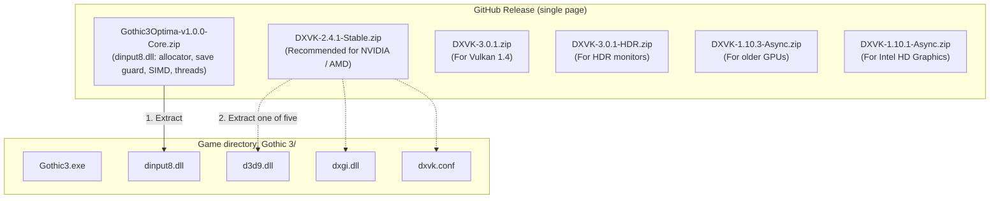
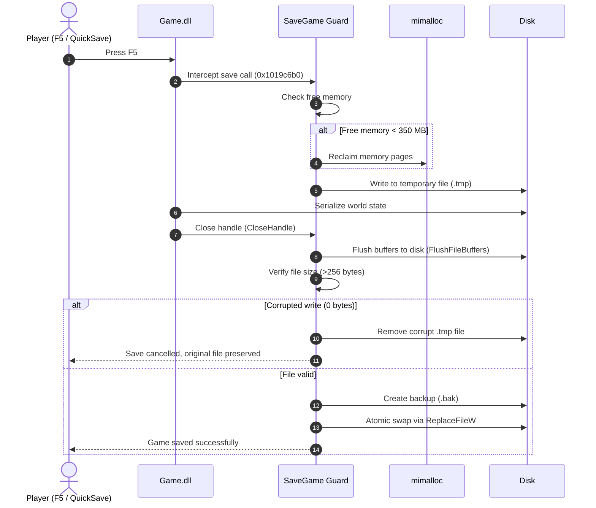

<div align="center">

**English** · [Русский](README.md)

# Gothic 3 Optima (G3O) Test version

### Engine optimization library, DXVK integration, and save protection for Gothic 3

[](file:///E:/SteamLibrary/steamapps/common/Gothic%203)
[](https://github.com/doitsujin/dxvk)
[](https://github.com/microsoft/mimalloc)
[](https://github.com/ebiggers/libdeflate)
[-orange.svg?style=flat-square)](CMakeLists.txt)
[](LICENSE)

<br />

**[Installation](#installation) · [Release Packages](#release-packages) · [Changes Table](#changes-table) · [Save Protection](#save-protection) · [Building](#building) · [FAQ](#faq)**

<br />

</div>

---

## Overview

**Gothic 3 Optima (G3O)** is a native proxy DLL (`dinput8.dll`) loaded by `Gothic3.exe` on startup. It hooks engine routines across Genome Engine libraries (`Engine.dll`, `Game.dll`, `SharedBase.dll`, `FileSystem.dll`, `PhysXCore.dll`).

The project addresses core technical issues in the original game:
1. **World streaming stutters** - solved with multicore archive loading and fast SIMD decompression via libdeflate.
2. **"Where is the guru?" crashes** - replaces the stock heap allocator with mimalloc, enables LFH on all heaps, and mitigates x86 virtual memory exhaustion.
3. **Savegame corruption (0-byte files on crash)** - writes saves to a temporary file first, verifies file integrity, and atomically swaps the destination file with automatic `.bak` backups.
4. **Direct3D 9 single-thread draw bottlenecks** - eliminates redundant RenderState calls and translates DirectX 9 to Vulkan via DXVK.

---

## Installation

Releases are split into the **Core engine mod** and **DXVK packages** tailored to different GPU generations:



### Steps:

1. **Download the Core mod:**
   - Grab `Gothic3Optima-v1.0.0-Core.zip` from the release page.
   - Copy `dinput8.dll` into your Gothic 3 game directory (next to `Gothic3.exe`).
2. **Download the DXVK package for your GPU:**
   - Pick the appropriate DXVK archive from the table below on the same release page.
   - Copy the extracted files (`d3d9.dll`, `dxgi.dll`, `dxvk.conf`) into the game directory.
3. **Launch the game** normally via Steam, GOG, or `Gothic3.exe`.

---

## Release Packages

All archives are attached to the same release on GitHub:

### 1. Core Mod (Required)
| Package | Size | Description |
| :--- | :--- | :--- |
| **`Gothic3Optima-v1.0.0-Core.zip`** | ~80 KB | Core mod (`dinput8.dll`). Includes mimalloc allocator replacement, SaveGame Guard, SIMD geometry acceleration, worker thread pool expansion, and exception handler. Works on native D3D9 or with any DXVK build. |

### 2. DXVK Variants (Pick one)
| Package | Version | Recommendation |
| :--- | :--- | :--- |
| **`DXVK-2.4.1-Stable.zip`** | DXVK 2.4.1 Stable | **Recommended default.** Best balance of stability and performance for most hardware: AMD Radeon (Polaris, Vega, RDNA 1-3) and NVIDIA GeForce (GTX 10xx, RTX 20xx/30xx/40xx). |
| **`DXVK-3.0.1.zip`** | DXVK 3.0.1 | Current release. Requires modern drivers with full Vulkan 1.4 support. |
| **`DXVK-3.0.1-HDR.zip`** | DXVK 3.0.1 HDR | Build with native HDR output. Use if playing on an HDR monitor or TV with Windows HDR turned on. |
| **`DXVK-1.10.3-Async.zip`** | DXVK 1.10.3 Async | For older GPUs lacking Vulkan 1.3 support, or if DXVK 2.x causes driver timeouts. |
| **`DXVK-1.10.1-Async.zip`** | DXVK 1.10.1 Async | For Intel HD/UHD integrated graphics or legacy hardware. |

> [!TIP]
> For standard gaming PCs, use: **`Gothic3Optima-v1.0.0-Core.zip`** + **`DXVK-2.4.1-Stable.zip`**.

---

## Changes Table

Comparison between stock Gothic 3 (CP 1.75.14) and the mod:

| Subsystem | Vanilla Behavior | Issue | Solution in Mod | Result |
| :--- | :--- | :--- | :--- | :--- |
| **Saves** | In-place file rewrite (`0x1019c6b0`), truncates to 0 on open | Corrupt 0-byte saves if game crashes during F5 | **SaveGame Guard:** cache flush, write to `.tmp`, verify size, atomic `ReplaceFileW` | Saves remain uncorrupted even on sudden crash or power loss |
| **Memory** | Engine `bCMemoryAdmin`, `_new@8` with `MemHeap::s_cLock` spinlock, CRT `HeapAlloc` | x86 address space fragmentation, lock stalls, OOM crashes ("Where is the guru?") | Complete swap of `bCMemoryAdmin`, `_new@8`, `MemHeap`, and IAT `HeapAlloc` with **mimalloc** using three isolated pools (Engine, MemHeap, ShortUsage) + LFH | External heap fragmentation eliminated, no lock contention, memory crashes resolved |
| **Graphics** | D3D9 without `D3DCREATE_PUREDEVICE`, textures kept in system RAM | High RAM usage, CPU validation overhead in driver | **DXVK** + forced `D3DCREATE_PUREDEVICE` flag | Textures offloaded to VRAM, freeing ~1 GB system RAM |
| **D3D9 States** | Engine emits thousands of redundant `SetRenderState` calls per frame | CPU draw call bottleneck | **State Filter:** shadow table filters duplicate calls | Reduced driver overhead, improved 1% low frametimes |
| **Streaming Threads** | `eCThreadPool` (`0x101f4010`) only runs 1-2 workers | Visible hitching when entering new world sectors | Hooked `eCThreadPool::Create`, scales to 4-8 workers | Parallel decompression utilizing multicore processors |
| **Resource Cache** | Aggressive resource eviction in `eCBaseCache` | Stutter when quickly looking back | Eviction throttled while plenty of free memory exists | Eliminates hitches when moving back and forth within an area |
| **Decompression** | Scalar `zlib 1.2.5` in `FileSystem.dll` | Traversal CPU spikes decompressing `.pak` chunks | Integrated **libdeflate** with AVX2 / SSE4.2 SIMD (hook at RVA `0xA430`) | 3-4x faster archive decompression |
| **File I/O** | Synchronous `SetFilePointer` and small-buffer `ReadFile` calls | Disk seek latency, repeated kernel transitions | **Memory-Mapped Files (`MapViewOfFile`):** direct file mappings (750 MB budget) | In-memory archive access without disk stalls |
| **Sector Streaming** | Static radial sphere around hero in `eCPVSPrefetcher3` | Micro-stutters (50-200 ms) when crossing sector boundaries | **Motion Vector Prefetch:** sphere projected 10-30m ahead along motion vector | Seamless streaming: sector cells loaded before hero arrives |
| **Math & Physics** | Calculations use legacy x87 FPU (`fld`, `fmul`, `fstp`) in `SharedBase.dll` | Slow Frustum Culling and bounding volume checks | Replaced culling and matrix math with SSE intrinsics | Faster visibility calculations |
| **Fall-Through Guard** | Raycast misses on polygonal seams and cliff meshes | Hero clipping through terrain into the void, lethal fall damage | **Ground Recovery Fall Guard:** detects unphysical vertical drops ($>6$m in 1 frame), restores safe ground | Hero never falls through geometry or dies from collision bugs |
| **String Hashing** | Byte-by-byte loop in `g_GetHashValue<bCString>` | Map lookup delays during NPC spawning | Vectorized string hash routine | Faster object and dialogue map lookups |
| **CPU Topology** | Threads randomly scheduled onto slow E-cores | Frame drops on Intel 12-14th Gen and AMD Hybrid chips | Game threads bound to Performance cores (P-cores) | Consistent framerate on hybrid processors |
| **PhysX Physics** | PhysX 2.4.1 locked to 2 threads, queries defunct Ageia PPU hardware | FPS drops in battles with ragdolls | SDK creation hooked, memory routed through mimalloc | Smoother physics simulation during mass fights |
| **Frame Pacing** | Stock Windows timer resolution defaults to 15.6 ms | Jittery frame delivery even at 60 / 120 FPS | Forced `timeBeginPeriod(1)` for 1.0 ms precision | Consistent frame pacing |
| **FMOD Audio** | Small DSP buffer in `fmodex.dll` (512 samples, 10.6 ms), 16 KB file buffer | Audio clicks, crackles, background music stopping in cities | Hooked `FMOD::System::init`: 2048x4 samples DSP buffer (170.6 ms), 64 channels, 64 KB stream buffer | Clean audio without crackles, uninterrupted music under load |
| **Address Space** | 32-bit limit (4 GB virtual memory space) | Insufficient space to keep world assets in memory | **Heaven's Gate (`heavens_gate/`):** in-process x86 to x64 transition for buffer allocations | Allows large off-heap cache buffers beyond 4 GB |

---

## Save Protection

How SaveGame Guard works:



---

## Code Structure

- `heavens_gate/` - x86 to x64 bridge via segment selector switch (`retf 0x33`) to allocate memory beyond 4 GB using 64-bit `ntdll.dll`.
- `src/memory_allocator.cpp` & `src/lfh_enforcer.cpp` - complete swap of `bCMemoryAdmin`, global `_new@8`, `MemHeap` methods, and IAT `HeapAlloc` with mimalloc using three isolated lifetime-based pools; enforces LFH on system heaps.
- `src/d3d9_hook.cpp` - adds `D3DCREATE_PUREDEVICE`, maintains shadow render state cache to filter duplicate D3D9 calls.
- `src/streaming_optimizer.cpp` - maps `.pak` archives into RAM via `MapViewOfFile`, predictive cell prefetching by motion vector (`eCPVSPrefetcher3`), and expands `eCThreadPool` to 4-8 worker threads.
- `src/media_optimizer.cpp` - integrates `libdeflate` (AVX2/SSE4.2) for fast archive decompression, expands FMOD Ex DSP buffer (2048x4), and sets 1.0 ms high-resolution timer.
- `src/math_simd_optimizer.cpp` - replaces `bCFrustum::Cull` and matrix operations with SSE vector intrinsics.
- `src/fall_guard.cpp` - protects player from falling through world geometry meshes and negates fall damage on collision glitches.
- `src/savegame_guard.cpp` - writes saves to `.tmp`, verifies file size, creates `.bak` backup, and performs atomic replacement via `ReplaceFileW`.
- `src/version_watermark.cpp` - displays Gothic 3 Optima version and status in the game's main menu.

---

## Building

### Requirements:
- Windows 10 / 11 (x64)
- Visual Studio 2022 (MSVC v143 x86)
- CMake 3.20+
- Git

### Build:

```cmd
git clone https://github.com/VadimGlinskiy/G3O.git
cd G3O

cmake -B build -S . -A Win32 -DCMAKE_BUILD_TYPE=Release
cmake --build build --config Release
```

Output binary: `build/Release/dinput8.dll`.

To package all release archives:
```powershell
powershell -ExecutionPolicy Bypass -File .\scripts\package_releases.ps1
```
Archives will be generated in `dist/packages/`.

---

## FAQ

<details>
<summary><strong>Is this compatible with Community Patch 1.75.14 and Update Pack 1.04.11?</strong></summary>

Yes. It was developed and verified against Gothic 3 v1.75.14 with Update Pack v1.04.11. All binary offsets and structures match.
</details>

<details>
<summary><strong>Does it work with mods (Questpaket, Content Mod, LCTM)?</strong></summary>

Yes. The mod only modifies binary engine code and OS API calls. Quest scripts, balance tables, and asset templates are untouched.
</details>

<details>
<summary><strong>How to enable the DXVK HUD (FPS, memory)?</strong></summary>

Open `dxvk.conf` in your Gothic 3 folder and add:
```ini
dxvk.hud = fps,frametimes,memory,devinfo
```
</details>

<details>
<summary><strong>What to do if there is a black screen or Vulkan error on startup?</strong></summary>

Use `DXVK-1.10.1-Async.zip` or `DXVK-1.10.3-Async.zip`. They have broader compatibility with older GPUs and legacy drivers.
</details>

<details>
<summary><strong>Where are save backups stored?</strong></summary>

In your standard save directory (`Documents\gothic3\`). On every save overwrite, the previous save is kept as `.bak`. If needed, rename it back to `.g3savdat`.
</details>

---

## Acknowledgements & Third-Party Components

Gothic 3 Optima builds upon and benefits from the research, work, and open-source libraries created by the following projects and authors:

| Component / Project | Author / Maintainer | License | Role in Gothic 3 Optima |
| :--- | :--- | :--- | :--- |
| **[DXVK](https://github.com/doitsujin/dxvk)** | Philip Rebohle ([doitsujin](https://github.com/doitsujin)) & contributors | Zlib License | Direct3D 9 to native Vulkan translation layer, offloading texture creation and shader compilation to asynchronous Vulkan transfer queues, enabling 32-bit floating point depth buffers. |
| **[DXVK-Async](https://github.com/Sporif/dxvk-async)** | [Sporif](https://github.com/Sporif) | Zlib License | Asynchronous graphics pipeline compilation patch for classic DXVK 1.10.x builds. |
| **[mimalloc](https://github.com/microsoft/mimalloc)** | Daan Leijen ([Microsoft Research](https://github.com/microsoft)) | MIT License | High-performance compact memory allocator eliminating external heap fragmentation and replacing the slow engine heap manager `bCMemoryAdmin`. |
| **[libdeflate](https://github.com/ebiggers/libdeflate)** | Eric Biggers ([ebiggers](https://github.com/ebiggers)) | MIT License | Fast zlib/deflate decompression library with hardware SSE4.2 / AVX2 SIMD acceleration for unpacking meshes and textures from `.pak` archives. |
| **[MinHook](https://github.com/TsudaKageyu/minhook)** | Tsuda Kageyu ([TsudaKageyu](https://github.com/TsudaKageyu)) | BSD 2-Clause | Minimalist and thread-safe low-level x86 API hooking library (detours and trampolines). |
| **[Heaven's Gate](https://github.com/Gothic3Optima)** | Roy M. ([ReWolf](https://github.com/mwrl)), mixcode, antivm | Public Domain | Architectural concept for switching the CPU from x86 to x64 mode via segment selector `0x33` to allocate large off-heap cache buffers beyond the 4 GB virtual address limit on 64-bit Windows. |
| **Community Patch Team (CPT)** | CPT Team | - | For the colossal work on Community Patch 1.75.14, reverse engineering Genome Engine binaries, and saving Gothic 3. |
| **Update Pack Team** | zandr, Dimus, and the World of Players community | - | For developing Update Pack 1.04.11, fixing hundreds of quests/scripts, and stabilizing `Engine.dll` / `Game.dll`. |
| **Piranha Bytes** | Piranha Bytes | - | Creators of the timeless Gothic universe and the original Genome Engine. |

---

## License

Gothic 3 Optima source code is released under the [MIT License](LICENSE).  
All third-party components remain the property of their respective authors and are distributed under their original licenses.
