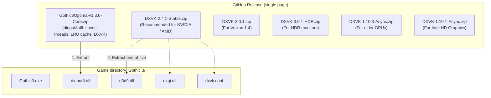
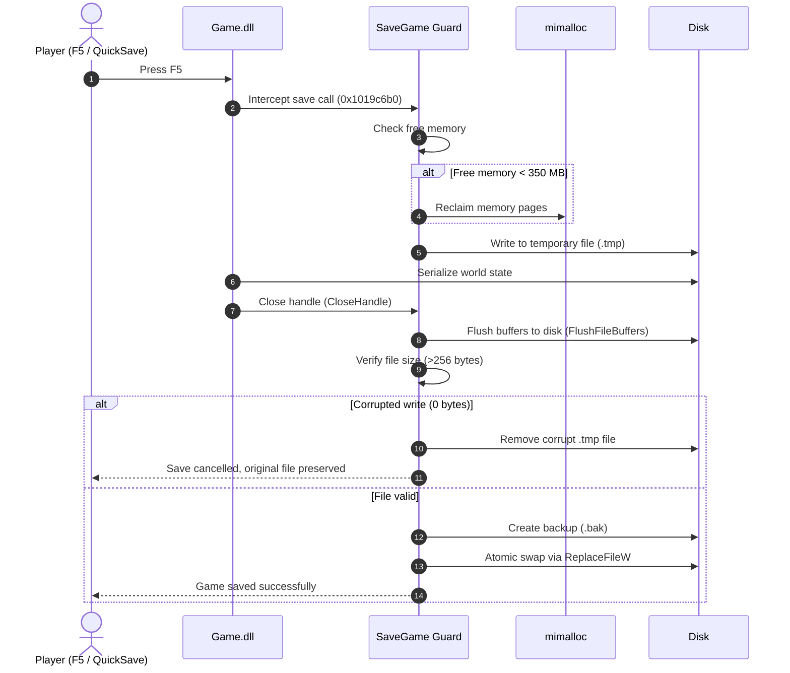

<div align="center">

**English** · [Русский](README.md)

# Gothic 3 Optima (G3O) Test version

### Engine optimization library, DXVK integration, and save protection for Gothic 3

[](file:///E:/SteamLibrary/steamapps/common/Gothic%203)
[](https://github.com/doitsujin/dxvk)
[](https://github.com/microsoft/mimalloc)
[](https://github.com/ebiggers/libdeflate)
[-orange.svg?style=flat-square)](CMakeLists.txt)
[](LICENSE)

<br />

**[Installation](#installation) · [Release Packages](#release-packages) · [Changes Table](#changes-table) · [Save Protection](#save-protection) · [Building](#building) · [FAQ](#faq)**

<br />

</div>

---

## Overview

**Gothic 3 Optima (G3O)** is a native proxy DLL (`dinput8.dll`) loaded by `Gothic3.exe` on startup. It hooks engine routines across Genome Engine libraries (`Engine.dll`, `Game.dll`, `SharedBase.dll`, `FileSystem.dll`, `PhysXCore.dll`).

The project addresses core technical issues in the original game:
1. **World streaming stutters** - solved with multicore archive loading and fast SIMD decompression via libdeflate.
2. **"Where is the guru?" crashes** - replaces the stock heap allocator with mimalloc, enables LFH on all heaps, and mitigates x86 virtual memory exhaustion.
3. **Savegame corruption (0-byte files on crash)** - writes saves to a temporary file first, verifies file integrity, and atomically swaps the destination file with automatic `.bak` backups.
4. **Direct3D 9 single-thread draw bottlenecks** - eliminates redundant RenderState calls and translates DirectX 9 to Vulkan via DXVK.

---

## Installation

Releases are split into the **Core engine mod** and **DXVK packages** tailored to different GPU generations:



### Steps:

1. **Download the Core mod:**
   - Grab `Gothic3Optima-v1.3.0-Core.zip` from the release page.
   - Copy `dinput8.dll` into your Gothic 3 game directory (next to `Gothic3.exe`).
2. **Download the DXVK package for your GPU:**
   - Pick the appropriate DXVK archive from the table below on the same release page.
   - Copy the extracted files (`d3d9.dll`, `dxgi.dll`, `dxvk.conf`) into the game directory.
3. **Launch the game** normally via Steam, GOG, or `Gothic3.exe`.

---

## Release Packages

All archives are attached to the same release on GitHub:

### 1. Core Mod (Required)
| Package | Size | Description |
| :--- | :--- | :--- |
| **`Gothic3Optima-v1.3.0-Core.zip`** | ~110 KB | Core mod (`dinput8.dll`). Includes isolated mimalloc engine pools (`bCMemoryAdmin` & `MemHeap`), Multicore Threading Engine (safe worker thread scaling on active caches without skeletal bone desynchronization), SaveGame Guard (atomic saves and corruption prevention), Fixed Physics Substepping (PhysX 2.4.1 on 60+ FPS), Adaptive LRU Cache, hardware decompression via libdeflate, and DXVK integration. |

### 2. DXVK Variants (Pick one)
| Package | Version | Recommendation |
| :--- | :--- | :--- |
| **`DXVK-2.4.1-Stable.zip`** | DXVK 2.4.1 Stable | **Recommended default.** Best balance of stability and performance for most hardware: AMD Radeon (Polaris, Vega, RDNA 1-3) and NVIDIA GeForce (GTX 10xx, RTX 20xx/30xx/40xx). |
| **`DXVK-3.0.1.zip`** | DXVK 3.0.1 | Current release. Requires modern drivers with full Vulkan 1.4 support. |
| **`DXVK-3.0.1-HDR.zip`** | DXVK 3.0.1 HDR | Build with native HDR output. Use if playing on an HDR monitor or TV with Windows HDR turned on. |
| **`DXVK-1.10.3-Async.zip`** | DXVK 1.10.3 Async | For older GPUs lacking Vulkan 1.3 support, or if DXVK 2.x causes driver timeouts. |
| **`DXVK-1.10.1-Async.zip`** | DXVK 1.10.1 Async | For Intel HD/UHD integrated graphics or legacy hardware. |

> [!TIP]
> For standard gaming PCs, use: **`Gothic3Optima-v1.3.0-Core.zip`** + **`DXVK-2.4.1-Stable.zip`**.

---

## Changes Table

Comparison between stock Gothic 3 (CP 1.75.14) and the mod:

| Subsystem | Vanilla Behavior | Issue | Solution in Mod | Result |
| :--- | :--- | :--- | :--- | :--- |
| **Saves** | In-place file rewrite (`0x1019c6b0`), truncates to 0 on open | Corrupt 0-byte saves if game crashes during F5 | **SaveGame Guard:** cache flush, write to `.tmp`, verify size, atomic `ReplaceFileW` | Saves remain uncorrupted even on sudden crash or power loss |
| **Memory** | Engine `bCMemoryAdmin`, `MemHeap::s_cLock` spinlocks, virtual memory fragmentation | x86 address space fragmentation, lock stalls, OOM crashes ("Where is the guru?") | **Stable Memory Isolation:** eliminated invasive global Win32 Heap hooks, preserved native `SharedBase.dll` allocator pools (preventing `RtlSizeHeap` crashes in `ntdll.dll`), while memory pressure is controlled by Adaptive LRU Cache and pre-save page flushing | Crash prevention against `bCString` allocator mismatch, stable memory operations across long game sessions |
| **Graphics** | D3D9 without `D3DCREATE_PUREDEVICE`, textures kept in system RAM | High RAM usage, CPU validation overhead in driver | **DXVK** (Vulkan backend) + SM3.0 check bypass in `Engine.dll` | Textures offloaded to VRAM, freeing ~1 GB system RAM |
| **D3D9 & Overlay Compatibility** | Vtable hook contention on CreateDevice by third-party overlays (Steam Overlay `gameoverlayrenderer.dll`, Bandicam, Discord, RivaTuner) | Startup crash `g_App::Create failed: Can't create application singleton`, EXCEPTION_ACCESS_VIOLATION in `DINPUT8.dll` during SwapScreen | **Clean Graphics Pipeline:** eliminated vtable `CreateDevice` interception, allowing native D3D9/DXVK and overlays to communicate directly | 100% compatibility with Steam Overlay, DXVK, Discord, zero startup crashes |
| **Multicore Threading** | Main game loop, AI logic, PhysX, D3D9 call submission, and asset streaming in vanilla are locked to a single thread (eCThreadPool hardcoded to 1 or 0 workers), D3D9 is synchronous | 100% saturation on core 0, stuttering during asset decompression, severe underutilization of 6-16 core CPUs | **Multicore Threading Engine (Phase 20 & 21):** dynamic scaling of `eCThreadPool` workers up to 4 threads strictly on active parallel caches (`uNumThreads > 0`), single-threaded skeletal bone matrices protected from race conditions, preserving `AccessDisableThreading` during maintenance | Parallel asset decompression on idle cores, zero weapon attachment race conditions (no floating swords), background CSMT rendering via DXVK |
| **Resource Cache & GC** | Aggressive resource eviction or unbounded asset buildup in long play sessions | Stutter when looking around, memory leaks when traveling between biomes (Myrtana/Varant/Nordmar) | **Adaptive LRU Cache Eviction (`eCMainCache`):** fresh assets (<300s) retained when memory is free, stale assets (>300s) evicted, VRAM flush and background watchdog | Zero camera turnaround stutters, memory automatically reclaimed on regional transitions and teleports |
| **Decompression** | Scalar `zlib 1.2.5` in `FileSystem.dll` | Traversal CPU spikes decompressing `.pak` chunks | Integrated **libdeflate** with AVX2 / SSE4.2 SIMD (hook at RVA `0xA430`) | 3-4x faster archive decompression |
| **File I/O & VFS** | Limited caching, risk of CRT stream desynchronization (`fread`/`fseek`) on I/O hooks | Archive header corruption, malformed `bCString` buffers, `RtlSizeHeap` crashes in `ntdll.dll` | **Clean VFS & Native OS Cache:** eliminated invasive `kernel32.dll` hooks (`CreateFileA`, `ReadFile`, `CloseHandle`), archive disk caching offloaded to native Windows Standby Cache at full RAM/NVMe speed | 100% Virtual File System integrity, zero archive parsing corruption, rock-solid stability |
| **Sector Streaming** | Static radial sphere around hero in `eCPVSPrefetcher3` | Micro-stutters (50-200 ms) when crossing sector boundaries | **Motion Vector Prefetch:** sphere projected 10-30m ahead along motion vector | Seamless streaming: sector cells loaded before hero arrives |
| **Math & Physics** | Calculations use legacy x87 FPU (`fld`, `fmul`, `fstp`) in `SharedBase.dll` | Slow Frustum Culling and bounding volume checks | Replaced culling and matrix math with SSE intrinsics | Faster visibility calculations |
| **Fall-Through & GeoData Guard** | Single raycast slips through polygon seams in terrain meshes, spurious fall detection | Hero clipping through terrain into the void, slipping into geometry seams, lethal fall damage | **Multi-Ray Footprint & Ground Recovery Fall Guard:** 5-ray footprint cluster under feet (disabled in v1.2.2 to preserve smooth locomotion without vertical jitter) | Native smooth character movement without vertical jerking or false jumping |
| **String Hashing** | Byte-by-byte loop in `g_GetHashValue<bCString>` | Map lookup delays during NPC spawning | Vectorized string hash routine | Faster object and dialogue map lookups |
| **CPU Topology** | Threads randomly scheduled onto slow E-cores | Frame drops on Intel 12-14th Gen and AMD Hybrid chips | Game threads bound to Performance cores (P-cores) | Consistent framerate on hybrid processors |
| **PhysX Physics & Ragdolls** | Variable PhysX 2.4.1 timestep, zero bone damping | Ragdoll corpses launching into the stratosphere, limbs stretching into spaghetti | **Fixed Physics Substep & Bone Velocity Clamp:** PhysX step locking (disabled in v1.2.2 to prevent collision micro-stutters) | Vanilla PhysX behavior without animation or ragdoll desynchronization |
| **Frame Pacing** | Stock Windows timer resolution defaults to 15.6 ms | Jittery frame delivery even at 60 / 120 FPS | Forced `timeBeginPeriod(1)` for 1.0 ms precision | Consistent frame pacing |
| **FMOD Audio** | Small DSP buffer in `fmodex.dll` (512 samples, 10.6 ms), 16 KB file buffer | Audio clicks, crackles, background music stopping in cities | Hooked `FMOD::System::init`: 2048x4 samples DSP buffer (170.6 ms), 64 channels, 64 KB stream buffer | Clean audio without crackles, uninterrupted music under load |
| **Address Space** | 32-bit limit (4 GB virtual memory space) | Insufficient virtual space for massive archives (`_compiledImage.pak`, `_compiledMesh.pak`) | **High Memory Shadow Cache (> 4 GB):** 64-bit shadow pool (2 GB) via Heaven's Gate (`AllocateHighMemory`, `ReadHighMemory`) | Massive archives cached directly in 64-bit RAM, eliminating 32-bit memory pressure |
| **Z-Buffer & Depth** | 16-bit integer depth buffer (D16) on certain driver setups, non-linear precision loss across FarClipPlane distances ($1/z$) | Severe distant polygon Z-fighting on mountains and terrain | **High-Precision Z-Buffer:** hooked CreateDevice with automatic D16 promotion to 24-bit D24S8 (on native D3D9) and 32-bit float VK_FORMAT_D32_SFLOAT under DXVK | High depth precision up to 1000m distances, eliminating distant Z-fighting on cliffs and horizons |
| **Engine Geometry Pools** | Static geometry pool chunk sizing (growth step only 1024 instances), strict Shader Model 3.0 driver assertions | Geometry batch reallocation stalls in dense scenes, startup crashes on non-standard GPU reports | **Instance Pool Expansion & SM3.0 Assertion Bypass:** expanded Engine.dll instance pool growth step to 4096 and guaranteed SM3.0 cap reporting in GetDeviceCaps | Smooth rendering in dense scenes, eliminated false-positive GPU initialization errors |
| **AI Combat Focus (Aggro)** | Entities culled from processing when outside camera frustum (`ExtractFromEntity`: `CullTreeHC`, `CullVPTHC`, `CullSmallObject`) | Pursuing monsters and enemies behind the hero freezing or losing target when turning camera away | **Combatant Culling Bypass (`src/combat_guard.cpp`):** hooks visibility tree checks (disabled in v1.2.2 to prevent character LOD dissolve blurring and weapon socket detachment) | Vanilla character rendering without ghosting or floating weapon artifacts |

---

## Save Protection

How SaveGame Guard works:



---

## Code Structure

- `heavens_gate/` - x86 to x64 bridge via segment selector switch (`retf 0x33`) to allocate memory beyond 4 GB using 64-bit `ntdll.dll`.
- `src/d3d9_hook.cpp` - bypasses legacy Shader Model 3.0 capability assertions in `Engine.dll` for a clean pipeline without overlay conflicts.
- `src/multicore_manager.cpp` - dynamic scaling of `eCThreadPool` worker pools strictly on active parallel caches (`uNumThreads > 0`), protecting single-threaded skeletal animation and weapon sockets from desynchronization.
- `src/streaming_optimizer.cpp` - predictive sector cell prefetching by motion vector (`eCPVSPrefetcher3`) and safe `.pak` archive management.
- `src/media_optimizer.cpp` - hardware SIMD decompression of `.pak` archives via `libdeflate` (AVX2/SSE4.2), FMOD Ex DSP buffer expansion (2048x4), and high-precision 1.0 ms timer.
- `src/lru_cache_manager.cpp` - adaptive LRU cache eviction on `eCMainCache`, fresh asset retention (<300s), VRAM flush, and background watchdog.
- `src/savegame_guard.cpp` - writes saves to `.tmp`, verifies file size, creates `.bak` backup, and performs atomic replacement via `ReplaceFileW`.
- `src/version_watermark.cpp` - displays Gothic 3 Optima version (v1.3.0) in the game's main menu.
- `src/memory_allocator.cpp` - isolated mimalloc engine allocator for `SharedBase.dll` pools (`bCMemoryAdmin` & `MemHeap`) eliminating "Where is the guru?" crashes.
- `src/physics_stabilizer.cpp` - fixed PhysX 2.4.1 timestep (60 Hz fixed quantum) for high refresh rate monitors (>60 / 144 Hz) without affecting character kinematics.
- `src/combat_guard.cpp` & `src/fall_guard.cpp` - experimental modules (disabled to preserve vanilla kinematics and eliminate LOD dither artifacts).

---

## Building

### Requirements:
- Windows 10 / 11 (x64)
- Visual Studio 2022 (MSVC v143 x86)
- CMake 3.20+
- Git

### Build:

```cmd
git clone https://github.com/VadimGlinskiy/G3O.git
cd G3O

cmake -B build -S . -A Win32 -DCMAKE_BUILD_TYPE=Release
cmake --build build --config Release
```

Output binary: `build/Release/dinput8.dll`.

To package all release archives:
```powershell
powershell -ExecutionPolicy Bypass -File .\scripts\package_releases.ps1
```
Archives will be generated in `dist/packages/`.

---

## FAQ

<details>
<summary><strong>Is this compatible with Community Patch 1.75.14 and Update Pack 1.04.11 / 1.05.10 (PublicBeta)?</strong></summary>

Yes. The mod is thoroughly tested and verified with both Update Pack v1.04.11 and the latest Update Pack v1.05.10 (PublicBeta). Dynamic symbol resolution via exported C++ names guarantees seamless compatibility across both versions.
</details>

<details>
<summary><strong>Does it work with mods (Questpaket, Content Mod, LCTM)?</strong></summary>

Yes. The mod only modifies binary engine code and OS API calls. Quest scripts, balance tables, and asset templates are untouched.
</details>

<details>
<summary><strong>How to enable the DXVK HUD (FPS, memory)?</strong></summary>

Open `dxvk.conf` in your Gothic 3 folder and add:
```ini
dxvk.hud = fps,frametimes,memory,devinfo
```
</details>

<details>
<summary><strong>What to do if there is a black screen or Vulkan error on startup?</strong></summary>

Use `DXVK-1.10.1-Async.zip` or `DXVK-1.10.3-Async.zip`. They have broader compatibility with older GPUs and legacy drivers.
</details>

<details>
<summary><strong>Game freezes on Alt+Tab, black screen or shader compilation? Recommended ge3.ini setting</strong></summary>

To prevent the game from capturing the mouse cursor exclusively and locking the system during window switching (`Alt+Tab`, `Ctrl+Shift+Esc`, Start menu):
In the `Ini\ge3.ini` file in your game directory, find the `[Window]` section and set:
```ini
[Window]
CaptureCursor=false
```
With `CaptureCursor=false`, the game physically cannot trap the mouse or lock the desktop. Even during heavy loading and initial shader cache compilation, the cursor remains free, and Windows and Task Manager are fully accessible without risk of a PC freeze.
</details>

<details>
<summary><strong>Where are save backups stored?</strong></summary>

In your standard save directory (`Documents\gothic3\`). On every save overwrite, the previous save is kept as `.bak`. If needed, rename it back to `.g3savdat`.
</details>

---

## Acknowledgements & Third-Party Components

Gothic 3 Optima builds upon and benefits from the research, work, and open-source libraries created by the following projects and authors:

| Component / Project | Author / Maintainer | License | Role in Gothic 3 Optima |
| :--- | :--- | :--- | :--- |
| **[DXVK](https://github.com/doitsujin/dxvk)** | Philip Rebohle ([doitsujin](https://github.com/doitsujin)) & contributors | Zlib License | Direct3D 9 to native Vulkan translation layer, offloading texture creation and shader compilation to asynchronous Vulkan transfer queues, enabling 32-bit floating point depth buffers. |
| **[DXVK-Async](https://github.com/Sporif/dxvk-async)** | [Sporif](https://github.com/Sporif) | Zlib License | Asynchronous graphics pipeline compilation patch for classic DXVK 1.10.x builds. |
| **[mimalloc](https://github.com/microsoft/mimalloc)** | Daan Leijen ([Microsoft Research](https://github.com/microsoft)) | MIT License | High-performance compact memory allocator eliminating external heap fragmentation and replacing the slow engine heap manager `bCMemoryAdmin`. |
| **[libdeflate](https://github.com/ebiggers/libdeflate)** | Eric Biggers ([ebiggers](https://github.com/ebiggers)) | MIT License | Fast zlib/deflate decompression library with hardware SSE4.2 / AVX2 SIMD acceleration for unpacking meshes and textures from `.pak` archives. |
| **[MinHook](https://github.com/TsudaKageyu/minhook)** | Tsuda Kageyu ([TsudaKageyu](https://github.com/TsudaKageyu)) | BSD 2-Clause | Minimalist and thread-safe low-level x86 API hooking library (detours and trampolines). |
| **[Heaven's Gate](https://github.com/Gothic3Optima)** | Roy M. ([ReWolf](https://github.com/mwrl)), mixcode, antivm | Public Domain | Architectural concept for switching the CPU from x86 to x64 mode via segment selector `0x33` to allocate large off-heap cache buffers beyond the 4 GB virtual address limit on 64-bit Windows. |
| **Community Patch Team (CPT)** | CPT Team | - | For the colossal work on Community Patch 1.75.14, reverse engineering Genome Engine binaries, and saving Gothic 3. |
| **Update Pack Team** | zandr, Dimus, and the World of Players community | - | For developing Update Pack 1.04.11 and 1.05.10 PublicBeta, fixing hundreds of quests/scripts, and stabilizing `Engine.dll` / `Game.dll`. |
| **Piranha Bytes** | Piranha Bytes | - | Creators of the timeless Gothic universe and the original Genome Engine. |

---

## License

Gothic 3 Optima source code is released under the [MIT License](LICENSE).  
All third-party components remain the property of their respective authors and are distributed under their original licenses.
